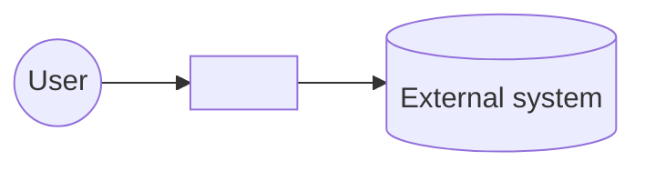
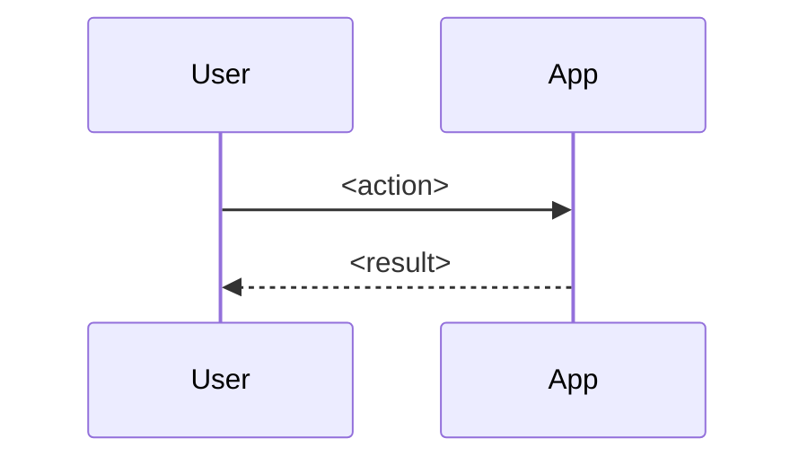

# <Product>: Architecture
<!-- Phase 3 output. At most 150 lines. Add detail only where a wrong guess would be expensive. -->
Status: draft | approved (YYYY-MM-DD)
Updated: YYYY-MM-DD · Hub: [STATE.md](STATE.md) · Upstream: [requirements.md](requirements.md)

## Context

## Stack
| Layer | Choice | Why (D-n) |
|-------|--------|-----------|
| <frontend / runtime / storage / hosting> | <…> | <…> |

## Components
- **C-1 <name>:** <responsibility>. Location: `src/<path>/`
- **C-2 <name>:** …

## Data model
<!-- Entities, key fields and relationships. Use a Mermaid erDiagram or a short list. -->

## Interfaces
<!-- API endpoints (method, path, request and response shape) and/or screens (S-n: purpose, key elements, wireframe link). -->

## Key flows

## Business rules
- **BR-1** <rule>, implementing FR-n

## Cross-cutting
- **Security and privacy:** <auth, data protection, top 3 abuse cases and their mitigations>
- **Errors:** <strategy, and what the user sees>
- **Observability:** <logs, metrics, scaled to the project>
- **Config and secrets:** <where they live; never in git>

## Deployment
<Target, environments, how a release works. Details are in [runbook.md](runbook.md).>

## Traceability
| Requirement | Components | Milestone |
|-------------|------------|-----------|
| FR-1 | C-1, C-2 | M1 |
