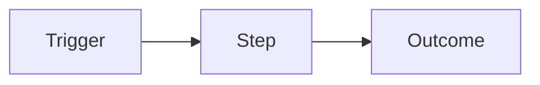

# <Product>: Product definition
<!-- Phase 1 output. Keep the prose to one page. Concept sketches go below it, or in concept/ with a link. -->
Status: draft | approved (YYYY-MM-DD)
Updated: YYYY-MM-DD · Hub: [STATE.md](STATE.md)

**Pitch:** <one sentence: for whom, what it does, why it's better than what they do today>

## Problem
<Who has the problem, what they do today instead, and what that costs them.>

## Users
- **<Persona>:** <context, goal, skill level>

## Value and strategy
- Why this, why now: <…>
- Success looks like: <a metric or demo, e.g. "a user logs a habit in under 5 seconds from opening the app">
- Constraints: <time, budget, hosting, mandated tech, the user's skills>

## Form
<Platform (web, mobile, CLI, API…), look and feel, where and how it's used.>

## Core journeys
- **J-1 <name>:** <trigger> → <steps> → <outcome>
- **J-2 <name>:** …

## Non-goals
- <What this explicitly won't do, at least for now.>

## Risks and unknowns
- **R-1** <risk>. Plan: <spike, or decide in phase n>

## Concept sketches
<!-- Mermaid flows, ASCII wireframes, or a link to concept/mockup.html and its screenshot. -->

